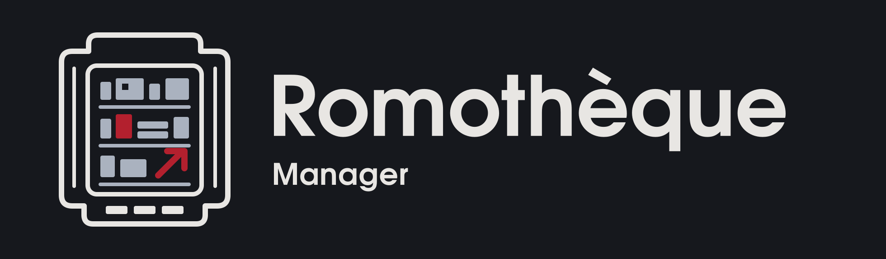

# ROMothèque Manager

**Explorer les collections rétro et les métadonnées associées sans déplacer ni modifier les ROM.** Application Windows en développement. **La version téléchargeable, le code de \`main\` et le candidat bêta en validation sont trois états différents.** Consulter [l'état vérifié](STATUS.md) avant tout essai.

## Télécharger et essayer

**Dernière Release effectivement publiée : [v0.4.0-alpha.1 — Windows x64](https://github.com/TobbyCy/RomothequeManager/releases/tag/v0.4.0-alpha.1)** (30.10.2026, NEXT-04.1). Il s'agit d'une **Alpha portable**, non signée et non qualifiée pour une ROMothèque personnelle.

1. Télécharger le [ZIP officiel de l'Alpha](https://github.com/TobbyCy/RomothequeManager/releases/download/v0.4.0-alpha.1/RomothequeManager-v0.4.0-alpha.1-win-x64.zip) et son [fichier SHA-256](https://github.com/TobbyCy/RomothequeManager/releases/download/v0.4.0-alpha.1/RomothequeManager-v0.4.0-alpha.1-win-x64.zip.sha256).
2. Comparer l'empreinte fournie avec \`Get-FileHash -Algorithm SHA256 .\RomothequeManager-v0.4.0-alpha.1-win-x64.zip\`. **Empreinte de l'archive publiée :** \`875e994e1ea0ebe0aa1d04e2256b7cd0593d05df7727892fe2553a8ca033cdea\`. Une empreinte vérifie les octets, **pas** la confiance ni une signature de l'éditeur.
3. Extraire entièrement le ZIP, garder les DLL et les notices \`licenses/\` à côté de l'application, puis lancer \`RomothequeManager.V2.exe\`. Le runtime .NET est embarqué ; aucun SDK .NET ni Node.js n'est requis pour cette Alpha.
4. Tester de préférence les démonstrations **fictives**. L'import historique ES-DE est volontaire et en lecture seule ; il ne vaut pas validation des données personnelles. Ne pas désactiver SmartScreen ou les protections globales de Windows.

**Cette Release** comprend l'accueil, les vues Collection/Fiche, recherche, filtres, pagination, diagnostics et l'import explicite de métadonnées ES-DE. **Elle ne contient pas** l'inventaire autonome NEXT-05, l'index média indépendant des XML, la persistance SQLite, le backup/restore métier ou un ZIP bêta IDEAL. Son import est conservé **en mémoire** et les jaquettes nécessitent une référence exploitable dans le XML. Aucune ROM, BIOS ou jaquette commerciale n'est distribuée.

## Capacités du code NEXT-05 — non distribuées dans l'Alpha

Le dépôt \`main\` au **02.11.2026, \`7aa62c8f\`** comprend désormais, avec preuves automatisées sur **fixtures synthétiques** : inventaire ROMS, index MEDIAS local séparé, projections et consentements distincts, séparation View/VM/service pour l'import et l'affichage historique ES-DE, annulation/générations, états Offline/Stale/Partial et conservation du dernier état cohérent, ainsi qu'un stockage SQLite minimal et des sauvegardes/restaurations contrôlées **en environnement de test**. Le module DocFX permanent est intégré (XML → YAML → HTML ; couverture Roslyn ≥90 % et 100 % nouvelles API). Ces capacités ne deviennent **pas** automatiquement des fonctions utilisables sur une bibliothèque réelle.

Le chantier [#154 — candidat bêta IDEAL](https://github.com/TobbyCy/RomothequeManager/pull/154) est encore **DRAFT et non fusionné** : son ZIP de validation est **quarantainé en CI, non téléversé ni publié**. Le contrôle de lancement GUI du véritable EXE extrait sous compte standard reste bloquant ; les autres preuves de CI ne compensent pas ce manque. La [recette Windows dédiée #95](https://github.com/TobbyCy/RomothequeManager/issues/95) sur fixtures reste **à exécuter**. Aucun GO Release ni accès aux collections personnelles.

| Situation | Statut réel |
| --- | --- |
| Alpha v0.4.0-alpha.1 | **PUBLIÉE** : métadonnées historiques ES-DE, sans SQLite NEXT-05 |
| Fonctionnalités fusionnées dans \`main\` | **INTÉGRÉES, fixtures uniquement** : ne sont pas la Release |
| PR #154 / candidat bêta | **EN VALIDATION, non distribué** : required checks rouges |
| Recette complète NEXT-05 sous Windows non-admin | **NOT_EXECUTED** sur le vrai candidat |
| Scraper, attribution automatique, copie/export/restructuration de ROM | **NON LIVRÉS / NON AUTORISÉS** |

Les permissions \`ROMS\`, \`MEDIAS\` et \`PREVIEW\` sont distinctes ; ni un résultat « complet », ni un chemin issu d'un XML, ni un aperçu n'accordent de permission générale. Les états \`OFFLINE\`, \`STALE\`, \`PARTIAL\` ou \`UNKNOWN\` ne sont jamais une preuve de suppression des jeux.

## Guides et contribution

[État actuel et historique](STATUS.md) · [Parcours IDEAL NEXT-05 et limites](docs/user/parcours-ideal-next05.md) · [FAQ/dépannage](docs/user/faq-depannage-next05.md) · [Sécurité](docs/user/securite-et-limites.md) · [Guide développeur](docs/developer/README.md) · [Parcours UX](docs/ux/next05-ideal-parcours.md) · [Journal technique](docs/product-status.md) · [Roadmap](docs/roadmap.md) · [Signaler un problème](https://github.com/TobbyCy/RomothequeManager/issues).

Ne joindre **que des fixtures fictives** aux tickets publics : aucun chemin privé, XML personnel, ROM, BIOS, jaquette commerciale ou donnée confidentielle. Le code original concerné est sous [MIT](LICENSE) ; **logos et assets officiels ne sont pas sous MIT**, voir [la notice graphique](assets/branding/README.md), [BRANDING](BRANDING.md) et [LEGAL](LEGAL.md). Le projet n'autorise ni scraping réseau ni redistribution de contenus tiers.
