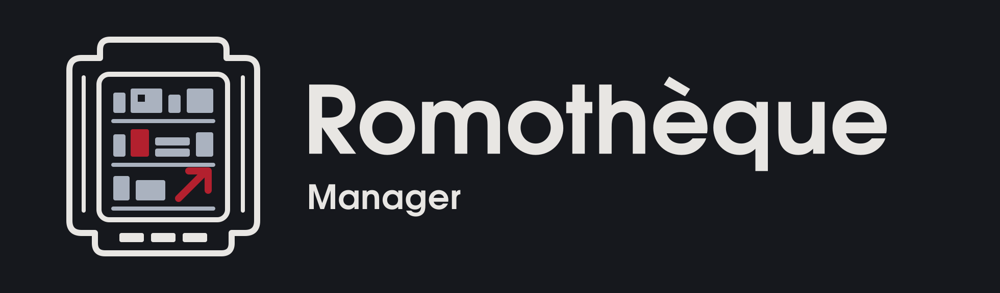

# ROMothèque Manager

  

**Explorer, comprendre et préparer l'organisation de ses collections de jeux rétro, en préservant les fichiers d'origine.**

ROMothèque Manager est un logiciel indépendant en développement actif, open source pour son code original. Il vise un catalogue local distinguant jeux, variantes, fichiers, métadonnées et observations d'inventaire. **Le catalogue persistant et les opérations de réorganisation ne sont pas encore livrés.**

> **Version de référence au 29 octobre 2026 : [v0.3.0-alpha.1 — Windows x64 portable (NEXT-03)](https://github.com/TobbyCy/RomothequeManager/releases/tag/v0.3.0-alpha.1).**
> Application de développement et de démonstration, avec runtime .NET inclus. Le premier import ES-DE est expérimental ; les scans personnels restent bloqués. Cette Alpha ne convient pas à la gestion d'une collection en production.
>
> **Aucune ROM commerciale, aucun BIOS ni jeu commercial n'est fourni ou proposé au téléchargement.**

## Télécharger et démarrer

1. Télécharger le [ZIP Windows x64 v0.3.0-alpha.1](https://github.com/TobbyCy/RomothequeManager/releases/download/v0.3.0-alpha.1/RomothequeManager-v0.3.0-alpha.1-win-x64.zip) et son [fichier SHA-256](https://github.com/TobbyCy/RomothequeManager/releases/download/v0.3.0-alpha.1/RomothequeManager-v0.3.0-alpha.1-win-x64.zip.sha256).
2. Vérifier l'empreinte dans PowerShell :
   `Get-FileHash -Algorithm SHA256 .\RomothequeManager-v0.3.0-alpha.1-win-x64.zip`.
   La comparer au fichier de contrôle et à la valeur ci-dessous.
3. **Extraire entièrement** l'archive dans un dossier accessible en écriture. Conserver ensemble l'exécutable, les DLL, les fichiers de données, les notices et le dossier `licenses`.
4. Lancer **`RomothequeManager.V2.exe`** depuis le dossier extrait, sans droits administrateur. Aucun SDK ni runtime .NET séparé n'est nécessaire.

**SHA-256 :** `07989c5f87b6fff605412cc54d43232f0f8b23632fa301341615e587e4a6e228`
**Commit source :** `131839ef342a60b7d2252a9fa174d8af1a446ee4`.

L'application n'est pas signée numériquement : Windows SmartScreen peut avertir. Ne pas désactiver les protections globalement. Le ZIP autonome ne constitue pas encore une garantie de conservation des paramètres ou du catalogue sur un SSD externe.

Les [notes de version](https://github.com/TobbyCy/RomothequeManager/releases/tag/v0.3.0-alpha.1) et le [compte rendu de publication vérifiée](https://github.com/TobbyCy/RomothequeManager/issues/74#issuecomment-6501928769) donnent les preuves de distribution. Les identifiants internes historiques V2-01C restent présents : cette version publique reprend le paquet NEXT-03 validé, sans recompilation. Les [deux Pre-releases historiques](https://github.com/TobbyCy/RomothequeManager/releases) restent disponibles.

## Ce que permet cette Alpha

| Domaine | Disponible dans v0.3.0-alpha.1 | Limites |
| --- | --- | --- |
| Interface Windows | Dashboard, bibliothèques, collection, recherche, pagination et fiches de jeux | Parcours et présentations encore en évolution |
| Démonstrations | Scénarios fictifs IDEAL, CHAOS et MYSTERY ; présentation d'états et de snapshots | Données synthétiques, sans preuve concernant une collection personnelle |
| Import ES-DE | Choix explicite d'une bibliothèque préparée, lecture des XML compatibles, réimport en mémoire | Compatibilité avec les bibliothèques personnelles non validée ; aucune persistance entre lancements |
| Métadonnées et médias | Titres, descriptions, plateformes et médias locaux déclarés ; aperçu image, miniature et logo | Pas de scraper, de découverte générale de médias ni de lecteur vidéo |
| Inventaire NEXT-03 | Présentation et simulation des états d'inventaire ; service et tests synthétiques intégrés | Le binaire public refuse le scan personnel ; la recette avec le vrai service utilise un harnais CI distinct |
| Favoris, sauvegarde et exports | Études et contrats disponibles dans les sources | Pas de gestion durable des annotations, de copie, conversion ou réorganisation de ROMs |

**Recette utilisateur Windows :** démarrage et navigation confirmés ; performances jugées excellentes, sans mesure comparative. Réserves connues : logo pixélisé, position de défilement perdue, import de bibliothèque réelle non validé et interface ultralarge perfectible. Ces réserves ne sont pas considérées corrigées par les travaux NEXT-04 encore en revue.

L'[état détaillé](docs/product-status.md) conserve également des comptes rendus historiques de préparation : leur mention « Draft » ou « non publié » doit être lue avec leur contexte. Pour le paquet effectivement distribué, se référer à la version et aux preuves ci-dessus.

## ES-DE : source historique, pas catalogue obligatoire à terme

EmulationStation Desktop Edition (ES-DE) est la première source historique de métadonnées importées. L'Alpha lit, pour chaque système, **soit** `ROMS/<systeme>/gamelist.xml`, **soit** `MEDIAS/<systeme>/metadata/es-de-gamelist.xml`, sous la racine choisie. Les deux sources simultanées sont refusées comme ambiguës.

Cela ne garantit pas la prise en charge de toutes les installations ES-DE : notamment, les dossiers modernes `ES-DE/gamelists` et `downloaded_media` ne sont pas pris en charge comme disposition générale par cette version. Sans XML compatible, l'import ne devient pas un catalogue vide réussi. Les chemins et médias sont contrôlés, les sources ne sont pas modifiées.

L'objectif futur est un catalogue interne indépendant des XML, enrichissable depuis plusieurs sources. **Ce stockage durable et ces enrichissements restent à développer** ([META-01](https://github.com/TobbyCy/RomothequeManager/issues/51)).

## Alpha, Bêta et version stable

| Stade | Signification pour ce projet |
| --- | --- |
| **Alpha — aujourd'hui** | Fonctions expérimentales, démonstrations et limites explicites ; format et parcours susceptibles d'évoluer |
| **Bêta — objectif proposé** | Parcours principal utilisable sur un périmètre réel défini, persistance et récupération éprouvées, recette Windows représentative |
| **1.0 stable — objectif proposé** | Périmètre principal accepté, données utilisateur protégées, distribution et maintenance reproductibles |

Ces critères sont des objectifs, sans date promise. NEXT-04 prépare l'import ES-DE et la navigation par systèmes : une PR ouverte ou une CI verte n'est pas une fonctionnalité distribuée. La [roadmap](docs/roadmap.md) expose les autres directions : catalogue, métadonnées, favoris, exports explicables et opérations physiques ultérieures.

## Protéger les collections personnelles

**Absence d'observation ≠ suppression d'un fichier ; fichier ≠ jeu identifié.** Un état Offline, Partial, Failed ou Stale conserve ses limites. La consultation d'un ancien snapshot ne prouve pas la présence actuelle des fichiers.

Aucun scan personnel automatique, déplacement, effacement ou réorganisation de ROMs n'est autorisé dans cette Alpha. L'import XML volontaire est distinct d'un inventaire de fichiers. Aucun résultat synthétique ni CI verte n'autorise une opération physique. Voir les [limites et précautions](docs/user/securite-et-limites.md).

Ne jamais publier de ROM, BIOS, XML personnel, chemin privé, capture de bibliothèque réelle ou secret dans GitHub. Les reproductions utilisent exclusivement des données fictives.

## Sources et contribution

| Chemin ou guide | Contenu |
| --- | --- |
| `src/RomothequeManager.V2/`, `tests/dotnet/` | Application Avalonia et tests .NET |
| `Modules/`, `Export/`, `Preflight/` | Moteur historique Windows PowerShell 5.1 et contrôles synthétiques |
| `prototype/ui11/` | Démonstrations web historiques ; ouvrir `index.html` ou `demo-integree.html` localement |
| [Démarrage développeur](docs/developer/README.md) | Environnement et références techniques ; certains repères sont historiques |
| [Workflow Git](docs/developer/workflow.md) | Contribution et validation indépendante |
| [Lexique](docs/user/lexique.md) · [UX](docs/ux/README.md) | Vocabulaire, parcours et intentions d'interface |
| [CHANGELOG](CHANGELOG.md) | Changements du code, distincts des versions distribuées |

Les démonstrations web utilisent uniquement des fixtures, sans scan ni connexion à une collection. Le [guide du prototype](prototype/ui11/README.md) précise leurs limites. Pour développer l'application, le SDK exact est défini par `global.json` ; il n'est pas nécessaire pour lancer le ZIP.

La [CI adaptative](https://github.com/TobbyCy/RomothequeManager/actions) exécute les contrôles applicables et un gate final obligatoire sur un SHA identifié. Une preuve automatisée ne remplace pas une recette humaine Windows ou une validation sur un périmètre réel autorisé.

Contributions : [CONTRIBUTING](CONTRIBUTING.md). Questions : [SUPPORT](SUPPORT.md). Vulnérabilités : [SECURITY](SECURITY.md), sans détail sensible dans une Issue publique.

## Licence et identité

Le **code original** et la **documentation originale dont la diffusion est autorisée** sont proposés sous **licence MIT** : [LICENSE](LICENSE) — **Copyright (c) 2026 Cyril Tobler**. Le projet est maintenu par [TobbyCy](https://github.com/TobbyCy).

Les logos, icônes et le bandeau officiels ont des droits distincts de la licence MIT du code ; consulter [BRANDING](BRANDING.md) et la [notice graphique](assets/branding/README.md).

ROMothèque Manager ne fournit, n'héberge ni ne distribue de ROM, BIOS, firmware propriétaire ou jeu commercial, ni de liens de téléchargement de jeux protégés. L'utilisateur doit disposer des autorisations applicables à ses contenus ; détenir un jeu original ne donne pas automatiquement le droit de télécharger une ROM depuis une source tierce. Le projet est indépendant des fabricants et éditeurs de jeux. Voir [LEGAL](LEGAL.md).
