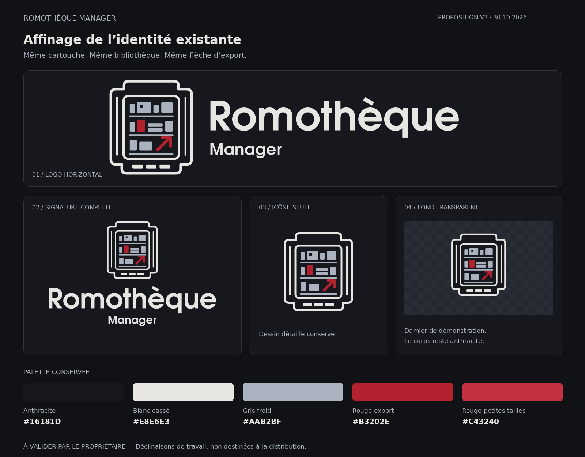
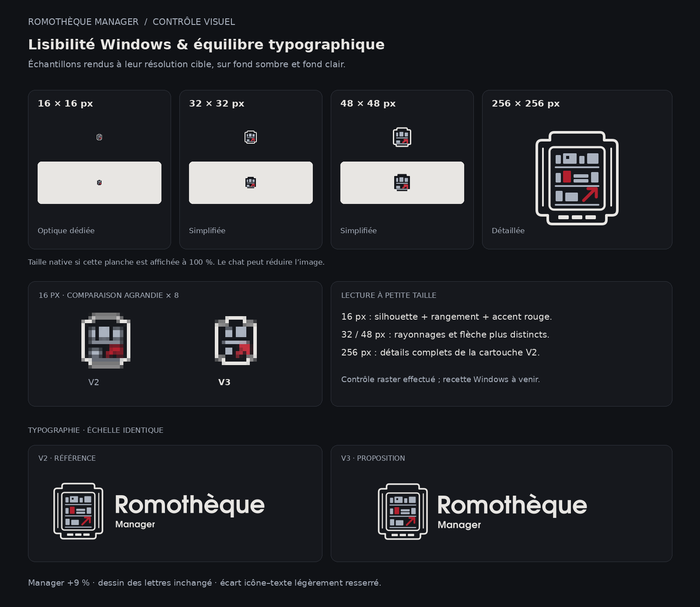

# ROMothèque Manager — proposition graphique V3

**30 octobre 2026 — PROPOSITION NON VALIDÉE.** Itération d’affinage de la V2 à soumettre au propriétaire. Les fichiers `work/` sont des sources de travail, pas un pack d’assets définitifs. Aucun nouvel ICO Windows ni pack de PNG transparents de distribution n’est livré à ce stade.

## Évolution proposée

- Cartouche, bibliothèque, flèche d’export et dessin détaillé : conservation des formes V2.
- Typographie : réutilisation de tous les tracés de lettres V2, sans nouvelle police ni substitution. « Romothèque » conserve sa taille relative ; « Manager » passe de 33 à 36 unités, soit +9,09 %, et reste secondaire.
- Espacement horizontal entre la cartouche visible et le texte : 50 → 40 unités. Alignement optique des deux lignes conservé, marges du canevas harmonisées.
- Signature complète centrée : déclinaison de composition utilisant les mêmes tracés.
- Icône 16 px : adaptation sur une grille dédiée ; deux blocs en haut, un en bas, rayonnage et flèche. Les très petits détails sont supprimés.
- Icônes 32 et 48 px : base simplifiée V2, tablette basse et flèche ajustées.
- Icône 256 px : dessin détaillé V2 inchangé.

## Palette soumise à validation

| Usage | Référence |
| --- | --- |
| Fond et corps de cartouche | `#16181D` |
| Contours et texte | `#E8E6E3` |
| Rayonnages et archives | `#AAB2BF` |
| Flèche et accent principaux | `#B3202E` |
| Accent optique proposé à 16 / 32 / 48 px uniquement | `#C43240` |

La version transparente conserve le corps anthracite de la cartouche ; seul le fond extérieur est transparent. Le damier appartient à la planche de présentation, jamais au SVG. Le logo horizontal clair est destiné aux interfaces sombres. Il ne constitue pas une variante typographique pour fond blanc.

## Contrôle visuel

Rendu raster avec Inkscape 1.2.2. Inspection visuelle des deux planches et des échantillons. Dimensions et transparence contrôlées ; aucun bord coupé aux quatre tailles. Voir `controle.json`.

| Taille | Source de travail | Observation |
| --- | --- | --- |
| 16 × 16 | `work/RM_V3_Proposition_Icone_16.svg` | Cartouche et accent rouge conservés. Le rayonnage est réduit à l’essentiel ; le sens précis de la flèche reste secondaire à cette échelle. |
| 32 × 32 | `work/RM_V3_Proposition_Icone_32_48.svg` | Structure de rangement et export plus distincts. |
| 48 × 48 | Même source simplifiée | Cartouche, blocs et flèche lisibles. |
| 256 × 256 | `work/RM_V3_Proposition_Icone_Detaillee.svg` | Ensemble des détails V2 conservé. |

La planche montre les échantillons à leur taille native lorsque le fichier est affiché à 100 %. Le chat et GitHub peuvent réduire l’aperçu. L’agrandissement ×8 du 16 px utilise les pixels sans interpolation. Les logos V2 et V3 de comparaison sont à la même échelle, malgré des canevas de dimensions différentes.

**Limite : contrôle de rendu uniquement.** Aucun test dans l’Explorateur, la barre des tâches ou une fenêtre Windows, aucun test DPI Windows, aucune construction ICO : `NOT_EXECUTED`. Ces vérifications appartiennent à la préparation des assets définitifs et à leur intégration après validation.

## Provenance et portée

- Source : `Romotheque_Manager_V2.zip`, livrée précédemment au propriétaire.
- SHA-256 du ZIP : `3b8d890767b926107fee5aa4d513c7d1d30d8f5344a062c6dfee47f0a92da84b`.
- Le SVG horizontal source a le même blob Git que `assets/branding/RM_V2_Horizontal_Couleur.svg` à la base `946e81c8a31ddfea4bc9c62346bf2b3c80f4d7c6` : `0dffbc85ae90aa88096b61fcc36c8d47c427b4e6`.
- Publication de cette proposition sur une branche graphique dédiée autorisée par le propriétaire dans son mandat du 30.10.2026.
- Aucun fichier existant modifié, aucun code applicatif, workflow, asset officiel, README racine ou référence d’intégration remplacé. Aucune fusion ni Release.
- Graphismes à droits réservés, distincts de la licence MIT du logiciel, conformément à [BRANDING.md](../../BRANDING.md). La proposition ne devient pas l’identité officielle du seul fait de sa présence dans cette branche.

## Décision propriétaire attendue

Valider la composition, la présence de « Manager » et l’adaptation des petites icônes, y compris le rouge optique. Après validation seulement : préparer les exports définitifs PNG transparents, SVG et ICO Windows multirésolution, puis organiser la recette Windows séparément.

## Complément demandé — logo horizontal 01 transparent

À la demande du propriétaire, ajout de [RM_V3_Horizontal_Transparent.png](RM_V3_Horizontal_Transparent.png), **1800 × 544 px RGBA**, et de [RM_V3_Horizontal_Transparent.svg](RM_V3_Horizontal_Transparent.svg). Le SVG est une copie exacte de la composition horizontale V3 de travail ; le PNG est son rendu à 200 %. Aucun changement de forme, de typographie ou de couleur. Le fond extérieur est transparent, le corps de cartouche reste anthracite et le texte clair est prévu pour un fond sombre. Dimensions, canal alpha, absence de découpe et rendu visuel contrôlés. Ce complément ne constitue pas le pack multirésolution complet ni une recette Windows.
