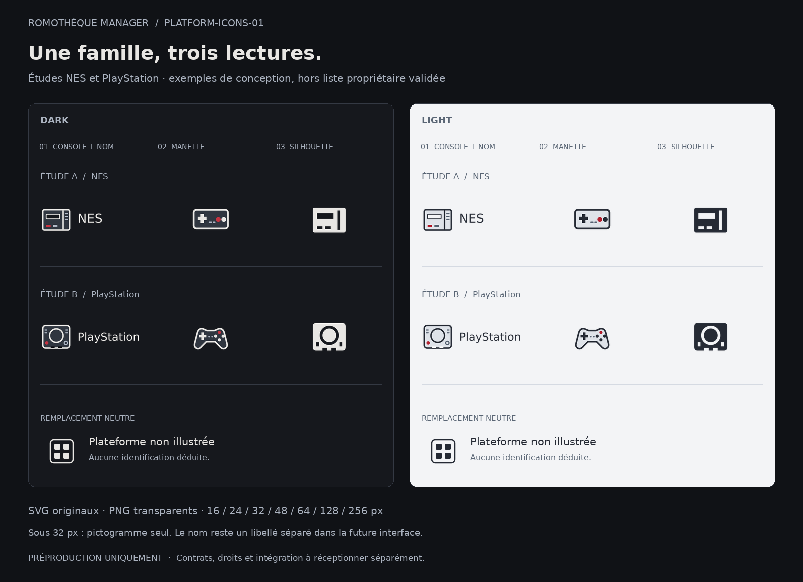
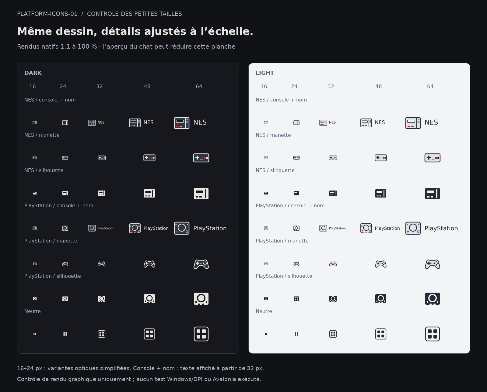

# PLATFORM-ICONS-01 — préproduction graphique, lot 0

**01.11.2026 — conception et prototypes seulement.** Mandat propriétaire : `OWNER_GO_PLATFORM_ICONS_GRAPHIC_PREPRODUCTION_ONLY / NEXT06_07_INTEGRATION_HOLD / NEXT05_UNCHANGED`.

Ce nouveau GO autorise la préproduction décrite ici malgré la mention historique `BACKLOG_ONLY` de [#120](https://github.com/TobbyCy/RomothequeManager/issues/120). Il n'autorise ni l'intégration, ni une adoption officielle, ni une Release. Le Graphiste ne se substitue pas au Contrôleur ou à DEV 2.

## Périmètre et étapes

1. **Lot 0 livré ici :** gabarits, règles communes, trois styles et remplacement neutre ; NES et PlayStation servent uniquement d'exemples graphiques. Leur présence dans la collection personnelle n'est ni recherchée ni affirmée.
2. **Première collection cible :** toutes les plateformes d'une liste de noms/PlatformKey explicitement validée par le propriétaire, avec les trois styles et les deux thèmes. Les deux études ne limitent pas cette collection.
3. **Extensions :** autres plateformes seulement après décision et lots ultérieurs. Aucune plateforme supplémentaire n'est inventée à partir d'une ROM, d'un nom de dossier ou d'un XML.

**Liste validée actuellement : vide.** `ownerValidatedPlatforms=[]`, `platformMappings=[]`, tous les `platformKey=null` dans le manifeste. Les identifiants `study-nes` et `study-playstation` sont des identifiants de dessin, pas des PlatformKey du produit. Le rattachement futur dépend de [#7](https://github.com/TobbyCy/RomothequeManager/issues/7).

## Direction proposée

| Famille | Traitement | Format |
| --- | --- | --- |
| Console + nom | Machine schématique, nom en typographie courante ; aucun logo constructeur | 192 × 64 ; pictogramme 64 × 64 sous 32 px de hauteur |
| Manette simplifiée | Contrôleur dessiné, repères essentiels, petit accent rouge | 64 × 64 |
| Silhouette de console | Masse monochrome et évidements, détails limités | 64 × 64 |
| Remplacement neutre | Quatre compartiments ; aucun constructeur ou console suggéré | 64 × 64, commun aux trois styles |

Grille 64, alignements sur pas de 4, angles modérés, trait courant 2,5 unités ; trait renforcé et détails réduits pour les exports 16 et 24 px. Aucune ombre, texture ni effet 3D. Gabarits dans `templates/`. Tokens précis et contrastes théoriques dans `tokens.json`.

| Couleur / usage | Dark | Light |
| --- | --- | --- |
| Fond de contrôle, absent des exports | `#16181D` | `#F3F4F6` |
| Structure et nom | `#E8E6E3` | `#252A34` |
| Corps secondaire | `#303640` | `#DFE3E9` |
| Détails | `#AAB2BF` | `#596574` |
| Accent | `#C43240` | `#B3202E` |

Les silhouettes et l'icône neutre n'utilisent pas le rouge. Le thème ne change jamais l'identité représentée. Les valeurs de fond servent aux planches, pas à dessiner un carré opaque autour des PNG.

## Livrables

- **28 sources SVG** autonomes : 12 variantes standard, 12 variantes optiques petites tailles, 4 variantes neutres.
- **2 gabarits SVG**, grille carrée et composition avec nom.
- **98 PNG transparents** dans le [pack de prototypes](PLATFORM_ICONS_01_Preproduction.zip) : 14 déclinaisons × 7 hauteurs, 16 / 24 / 32 / 48 / 64 / 128 / 256 px. Les badges avec nom ont une largeur égale à trois fois leur hauteur à partir de 32 px.
- Deux planches de contrôle, manifeste descriptif, contrôles techniques et provenance.
- [Contrat candidat](CONTRAT_CANDIDAT.md), [provenance](PROVENANCE.md) et [plan de conservation #90](CONSERVATION_90.md).

## Contrôles et limites

**Effectué :** génération raster Inkscape 1.2.2 ; 98 dimensions et canaux alpha contrôlés ; absence de bord coupé ; 28 SVG sans image embarquée, script, référence externe ou dépendance à une police installée. Les lettres sont converties en tracés. Inspection des deux planches et des rendus agrandis. Les résultats détaillés figurent dans `qa.json`.

**Lecture :** à 16 px, la silhouette est le repère principal ; détails de boutons et repères techniques sont secondaires. Les noms longs à 32 px restent petits : privilégier la variante sans texte si l'espace ou la lecture l'exige, en conservant un vrai libellé accessible dans l'interface future. Les planches montrent les pixels natifs uniquement à zoom 100 %.

**Non exécuté / non approuvé :** tests Windows/DPI, affichage Avalonia, intégration et sélecteur, contrat de résolution PlatformKey, revue DEV 2 des droits, validation de la direction par le Contrôleur. Les mesures de contraste sont celles des couleurs pleines sur deux fonds de contrôle, pas une certification d'accessibilité de l'application ou de chaque pixel anticrénelé.

## Réception attendue

Le Contrôleur reçoit la direction et décide de la suite ; DEV 2 examine le contrat candidat et les droits ; le propriétaire transmet et valide la liste. DEV 3 n'intègre qu'après mandat distinct. Aucun accès à une ROMothèque réelle, ROM, BIOS ou XML ; aucun asset graphique existant, code applicatif, CI ou PlatformKey modifié.
